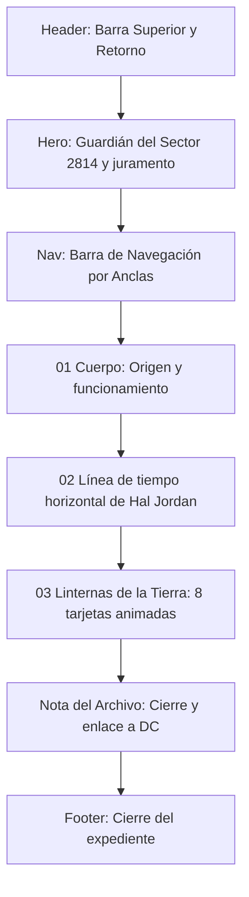

# Documentación Técnica y de Diseño UX/UI — Expediente Green Lantern

**Proyecto:** Expediente de Personaje / Dossier de Héroe (`green-lantern.html`)  
**Materia/Ámbito:** Programación Web Dinámica  
**Fecha:** Octubre 2026  
**Rol:** Desarrollador Frontend & Diseñador UX/UI  

---

## 1. Resumen Ejecutivo del Proyecto

La página de detalle **Green Lantern (Expediente 002 / DC)** es la vista profunda del héroe dentro de *Icons Archive*. Sigue la misma lógica de "dossier clasificado" que el expediente de Spider-Man, pero con una identidad cromática propia: el verde de la linterna del Cuerpo.

El contenido recorre el origen del Cuerpo de Green Lanterns, una línea de tiempo horizontal con la historia de Hal Jordan y un catálogo animado de Linternas de la Tierra con sus fotografías.

---

## 2. Concepto Visual y Sistema de Diseño (Design System)

### 2.1. Dirección de Arte: "Dossier Verde del Sector 2814"
La página reutiliza la estructura y los componentes del expediente de Spider-Man (barra superior, hero, navegación por anclas, bandas de historia, tarjetas y pie). Lo que cambia es la paleta y el contenido:

* **Atmósfera Noche Verde (`#060a09`):** Fondo casi negro con un matiz verde muy oscuro, que deja que la luz de la linterna sea el único color fuerte.
* **Luz de Linterna como acento:** El verde esmeralda marca los elementos interactivos, los kickers y los puntos clave, igual que el rojo en el expediente de Spider-Man.
* **Dorado reemplazado por verde menta:** Los acentos que en Spider-Man eran dorados ahora son verde menta claro (`--mint`), para mantener la legibilidad sobre el fondo oscuro.

### 2.2. Tipografía y Escala
Se mantiene la tríada tipográfica del expediente de Spider-Man:

| Familia Tipográfica | Rol en la Interfaz | Justificación Estilística |
|---|---|---|
| **Cinzel** (Serif) | Títulos principales, cabeceras de sección (`h1`, `h2`, `h3`) y el juramento del inicio | Autoridad y solemnidad de archivo, coherente con el resto de la colección. |
| **Barlow Condensed** (Sans-Serif) | Insignias, kickers, numeraciones, años de la línea de tiempo y botones | Rotulado técnico de cómic. |
| **DM Sans** (Sans-Serif) | Cuerpo de texto, descripciones y tarjetas | Legibilidad en lecturas extensas. |

### 2.3. Paleta Cromática y Tokens CSS (`green-lantern.css`)
```css
:root {
  color-scheme: dark;
  --bg: #060a09;               /* Fondo primario, noche verde */
  --bg-surface: #0c1311;       /* Superficie de paneles */
  --bg-card: #111a17;          /* Fondo de tarjetas */
  --panel: #0f1714;            /* Fondo de bloques */

  --text: #f8fafc;             /* Blanco tiza */
  --text-secondary: #cbd5e1;   /* Gris claro secundario */
  --muted: #94a3b8;            /* Metadatos */

  --green: #2ee678;            /* Verde linterna: acento principal */
  --green-hover: #6dfa9f;      /* Verde en interacción */
  --green-glow: rgba(46, 230, 120, 0.4);
  --green-subtle: rgba(46, 230, 120, 0.12);

  --mint: #b8f5cf;             /* Verde menta: textos de acento */
  --mint-glow: rgba(184, 245, 207, 0.3);
  --mint-subtle: rgba(184, 245, 207, 0.1);

  --line: rgba(255, 255, 255, 0.08);
}
```

---

## 3. Estructura y Arquitectura de Componentes



### 3.1. Barra de Encabezado (`.detail-top`)
* Enlace de retorno `← VOLVER AL SELECTOR` hacia `index.html`.
* Marca `ICONS ARCHIVE` y placa `EXPEDIENTE 002 / DC`.

### 3.2. Sección Hero (`#inicio`)
* **Capa de imagen (`.hero-art`):** Ilustración de Green Lantern a su proporción original (1624 × 2500), pegada al costado izquierdo. El resto del fondo es negro. En pantallas de 1200 px o más, el contenido se corre a la derecha de la imagen; en pantallas más chicas la imagen queda detrás del texto, atenuada.
* **Título:** `GREEN` en blanco y `LANTERN` en verde.
* **Juramento (`.oath`):** Se presenta como cita (`<blockquote>`) con la etiqueta `JURAMENTO DEL CUERPO`, los versos en líneas separadas y una línea de luz verde vertical al costado. El remate, *¡la luz de Linterna Verde!*, es más grande y tiene brillo verde, aura y humo (ver sección 4).
* **Emblema (`.hero-mark`):** Logo de Green Lantern (`img/green lantern/gl logo web.webp`) dentro de una órbita decorativa, con la coordenada `SECTOR 2814`.
* **Indicador de desplazamiento (`.scroll-cue`):** Enlace animado hacia la sección "Cuerpo".

### 3.3. Barra de Navegación por Secciones (`.section-nav`)
* Enlaces de salto rápido: `EL CUERPO`, `HAL JORDAN`, `LINTERNAS DE LA TIERRA`.
* **ScrollSpy de Bootstrap:** `<main data-bs-spy="scroll" data-bs-target=".section-nav">` marca con la clase `.active` el enlace de la sección visible, y `green-lantern.js` le suma `aria-current="location"` para los lectores de pantalla. No cambia el aspecto, porque el CSS no le da estilo a `.active`. Va en `<main>` y no en `<body>`, porque `body` tiene `overflow-x: hidden` y Bootstrap lo tomaría como contenedor de scroll (y nunca marcaría nada).
* En celulares se desplaza horizontalmente sin cortar el primer enlace (los márgenes automáticos a cada extremo reemplazan al centrado, que dejaba enlaces fuera de la pantalla).

### 3.4. Sección 01 / El Cuerpo (`#cuerpo`)
* **Banda de origen (`.story-band`):** Texto sobre los Guardianes del Universo, Oa, los Manhunters y el nacimiento del Cuerpo. Acompañada por un emblema con anillos giratorios (`.corps-ring`, `.story-emblem`).
* **Cita destacada (`.quote`):** Frase sobre el anillo y el miedo.
* **Grilla de funcionamiento (`.ability-grid`):** Cuatro tarjetas: Los Guardianes, 3600 sectores, La Batería Central y El anillo.

### 3.5. Sección 02 / Línea de Tiempo de Hal Jordan (`#hal-jordan`)
* **Encabezado:** `02 / LÍNEA DE TIEMPO · HAL JORDAN` y el título *La historia de Hal Jordan*, para dejar claro de quién es la línea.
* **Barra superior (`.h-timeline-bar`):** Indicador `HAL JORDAN · 1959 — 2004` con un punto verde que parpadea, y dos botones de flecha (`#halPrev`, `#halNext`).
* **Riel horizontal (`.timeline`):** Lista ordenada con seis hitos, de 1959 a 2004 (elegido por el anillo, Justice League, la ruta con Green Arrow, Parallax, *The Final Night* y *Rebirth*). Las tarjetas se ubican una al lado de la otra y se recorren con `overflow-x: auto` y `scroll-snap`, así cada paso se acomoda al inicio de una tarjeta.
  * Cada año dibuja su tramo de la línea de luz (`.timeline-item::before`); juntos forman una sola línea continua.
  * Un pulso de luz (`.timeline-item::after`) viaja por el riel, escalonado con la variable `--i`.
  * Un conector vertical une cada año con su tarjeta.
  * En hover, la tarjeta sube y el año se enciende en verde.
* **Barra de progreso (`.h-timeline-progress`):** Muestra qué parte de la línea ya se recorrió. Se recalcula con `ResizeObserver` cada vez que cambia el ancho de la línea (al redimensionar la ventana y también cuando terminan de cargar las fuentes).
* **Difuminado de bordes:** Aparece solo del lado donde quedan más tarjetas (clases `.is-start` / `.is-end`). Para saber si la línea está en un extremo se tiene en cuenta el `padding` de la lista: el `scroll-snap` deja el scroll en 4 px y no en 0 al inicio.
* **Formas de recorrerla:** flechas en pantalla, deslizar con el dedo o el trackpad, y las flechas del teclado cuando la línea tiene el foco.

> El perfil de Hal Jordan (tarjeta y ficha técnica) se quitó para que la sección se enfoque solamente en su historia.

### 3.6. Sección 03 / Linternas de la Tierra (`#linternas`)
* Grilla de **8 tarjetas** (`.lantern-grid`): Hal Jordan, Guy Gardner, John Stewart, Kyle Rayner, Simon Baz, Jessica Cruz, Jo Mullein y Alan Scott.
* Cada tarjeta tiene su foto (`.lantern-photo`), una etiqueta con la primera aparición (`.lantern-meta`), el nombre y una descripción corta.
* **Animación de entrada:** al llegar a la sección, las tarjetas suben una tras otra con un destello verde (`@keyframes gl-card-in`) y una franja de luz recorre cada foto (`@keyframes gl-scan`). Se activa con `IntersectionObserver` desde `green-lantern.js`.
* **Animación en hover:**
  * Inclinación 3D que sigue al mouse (variables `--rx` y `--ry`).
  * Borde de luz que gira alrededor de la tarjeta (`conic-gradient` con la propiedad animable `--gl-angle`).
  * La foto se agranda, gana color y vuelve a pasar la franja de luz.
  * El número y el nombre se encienden en verde.
* Sin JavaScript, las tarjetas se ven normales: las clases de animación (`.will-reveal`, `.is-visible`, `.is-done`) solo las agrega el script.

### 3.7. Nota del Archivo y Footer (`.curiosity` / `.detail-footer`)
* Frase de cierre sobre la voluntad como fuerza de los Linternas.
* Enlace externo al perfil oficial de DC (`dc.com/characters/green-lantern`) y botón `VOLVER AL INICIO ↑`.

---

## 4. Efecto del Juramento: Brillo Verde con Humo

El remate del juramento (`.oath-glow`) combina varias capas:

1. **Texto (`.oath-text`):** `text-shadow` en seis capas, de blanco a verde intenso, y un parpadeo leve (`@keyframes oath-flicker`, ciclo de 5 s) como el de una luz real.
2. **Reflejo:** un brillo blanco cruza las letras de izquierda a derecha (`.oath-text::after`, `@keyframes oath-sheen`).
3. **Aura (`.oath-aura`):** resplandor verde desenfocado detrás del texto, que late (`@keyframes oath-aura`).
4. **Línea de luz:** subrayado luminoso debajo de la frase (`.oath-glow::after`).
5. **Humo (`.oath-smoke`):** seis nubes verdes desenfocadas (`<i>`) que nacen en las letras, suben, se agrandan y se desvanecen (`@keyframes oath-smoke`). Tienen tiempos y duraciones distintos para que el humo no se vea repetido. El contenedor usa el filtro SVG `#gl-smoke` (`feTurbulence` + `feDisplacementMap`, definido al final del hero), que deforma las nubes para que parezcan vapor y no manchas redondas.

**Accesibilidad:** con `prefers-reduced-motion`, el humo queda quieto con opacidad fija y se detienen el parpadeo, el reflejo y el aura.

---

## 5. Ajustes Responsive

* **Título y juramento:** tamaños con `clamp()`. En pantallas de 900 px o menos el hero se centra y la línea lateral del juramento pasa a ser una línea horizontal arriba. En celulares los versos se unen en un solo párrafo.
* **Línea de tiempo:** en celulares cada tarjeta ocupa el 78% del ancho de la pantalla, así se ve que hay más tarjetas al costado.
* **Grilla de Linternas:** 4 columnas en escritorio, 2 en tablet y 1 en celular. Las tarjetas mantienen la proporción 4:5 en el área de imagen.
* **Desbordamiento horizontal:** se verificó en 390 y 1440 px. La página no tiene scroll lateral (la línea de tiempo se desplaza dentro de su propio contenedor).

---

## 6. Accesibilidad (A11y), Rendimiento y Estándares Web

* **Movimiento reducido:** las animaciones (humo, parpadeo, pulso del riel, entrada e inclinación de tarjetas, anillos y emblema) se neutralizan con `prefers-reduced-motion`. El script también lo consulta y no activa la entrada ni la inclinación 3D.
* **Semántica:** `<header>`, `<main>`, `<section>`, `<blockquote>` para el juramento, `<article>`, `<ol>` para la línea de tiempo y `<footer>`.
* **Teclado:** la línea de tiempo tiene `tabindex="0"` y se recorre con las flechas; los botones tienen `aria-label` y se deshabilitan al llegar a un extremo.
* **Elementos decorativos:** los anillos, el humo, el aura y la barra de progreso están marcados como decorativos (`aria-hidden`).
* **Enlaces externos:** `target="_blank"` con `rel="noreferrer"`.
* **JavaScript mínimo (`green-lantern.js`):** maneja la línea de tiempo, las animaciones de las tarjetas y el `aria-current` del menú. Si no carga, todo el contenido sigue visible y la línea de tiempo se puede deslizar igual.
* **Bootstrap:** el CSS se carga desde `bootstrap-layer.css`, dentro de una capa (`@layer`), así que no pisa ningún estilo de `green-lantern.css` (ver `documentacion/bootstrap.md`). El JS (`bootstrap.bundle.min.js`) se carga con `defer` y verificación de integridad (SRI).
* **Fuentes:** se piden con `<link>` y `preconnect` en el `<head>` en lugar de `@import` dentro del CSS, así el navegador empieza a descargarlas antes.

---

## 7. Fotos de las Linternas de la Tierra

Cada tarjeta de la sección 03 tiene su imagen oficial en formato WebP dentro de la carpeta `img/green lantern/`:

```html

```

Las 8 Linternas de la Tierra integradas son:
1. **Hal Jordan:** `img/green lantern/hal jordan.webp`
2. **Guy Gardner:** `img/green lantern/guy gardner.webp`
3. **John Stewart:** `img/green lantern/john stewart.webp`
4. **Kyle Rayner:** `img/green lantern/kyle rayner.webp`
5. **Simon Baz:** `img/green lantern/simon baz.webp`
6. **Jessica Cruz:** `img/green lantern/jessica cruz.webp`
7. **Jo Mullein:** `img/green lantern/jo mullein.webp`
8. **Alan Scott:** `img/green lantern/alan scott.webp`

Las imágenes se adaptan a la proporción 4:5 (`aspect-ratio: 4 / 5`) con recorte `object-fit: cover` centrado al 25% superior para priorizar rostros y torsos.

---

## 8. Mapa de Archivos del Proyecto

| Archivo | Tipo | Función Principal |
|---|---|---|
| `green-lantern.html` | HTML5 | Estructura semántica, contenido del expediente, juramento, línea de tiempo horizontal y tarjetas de Linternas con fotos. |
| `green-lantern.css` | CSS3 | Tokens verdes, maquetación, efecto del juramento, línea de tiempo horizontal, animaciones de las tarjetas y responsive. |
| `green-lantern.js` | JavaScript | Flechas, progreso y difuminado de la línea de tiempo; entrada al hacer scroll e inclinación 3D de las tarjetas; `aria-current` del menú (ScrollSpy). |
| `bootstrap-layer.css` | CSS3 | Bootstrap 5.3 dentro de una capa CSS, con una capa de compatibilidad que deshace su reset. |
| `index.html` / `styles.css` / `script.js` | HTML / CSS / JS | Selector principal. El botón "Abrir expediente" lleva a `green-lantern.html` cuando Green Lantern está seleccionado. |
| `documentacion/green-lantern.md` | Markdown | Este documento. |
| `documentacion/spider-man.md` | Markdown | Documentación del expediente de Spider-Man. |

---

## 9. Historial de Cambios

| Cambio | Detalle |
|---|---|
| Juramento rediseñado | Cita con etiqueta y línea lateral; remate con brillo, aura, reflejo y humo verde. Se reemplazó un intento anterior que dependía de un filtro `#smoke` inexistente. |
| Punto débil eliminado | Se quitó el bloque `.weakness` (el amarillo y Parallax) y sus estilos. |
| Perfil de Hal Jordan eliminado | Se quitaron la tarjeta de perfil y la ficha técnica, con sus estilos. |
| Línea de tiempo horizontal | Pasó de vertical a horizontal, con título propio que aclara que es sobre Hal Jordan. |
| Animaciones en Linternas | Entrada escalonada al hacer scroll y efectos de hover (3D, borde giratorio, escaneo). |
| Nuevo archivo | Se creó `green-lantern.js`. |
| Bootstrap | Se sumó Bootstrap 5.3 en una capa CSS (sin cambios visuales) y su ScrollSpy en el menú de secciones, con `aria-current`. |
| Fuentes | Pasaron de `@import` en el CSS a `<link>` con `preconnect` en el HTML. |
| Correcciones de la línea de tiempo | La flecha "←" no se deshabilitaba al inicio por el `scroll-snap`; la barra de progreso quedaba desactualizada hasta el primer scroll (ahora usa `ResizeObserver`). |

---

## 10. Pendientes y Observaciones

* **Enlace a DC:** Conviene probar el enlace externo para confirmar que sigue funcionando.
* **Imagen `.jxl` de la carpeta `img`:** `the-green-lantern-corps_dc-comics_silo_600x.jxl` no se usa, porque ese formato no se muestra en Chrome. Si se quiere usar, hay que convertirla a `.jpg` o `.webp`.
* **Fuentes y Bootstrap:** las tipografías vienen de Google Fonts y Bootstrap del CDN jsDelivr. Sin conexión, la página usa fuentes de reemplazo y funciona sin Bootstrap (el diseño no depende de él; solo se pierde el marcado del menú).
