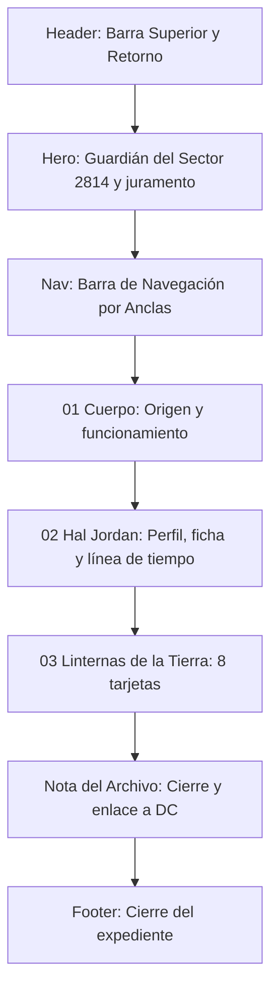

# Documentación Técnica y de Diseño UX/UI — Expediente Green Lantern

**Proyecto:** Expediente de Personaje / Dossier de Héroe (`green-lantern.html`)  
**Materia/Ámbito:** Programación Web Dinámica  
**Fecha:** Octubre 2026  
**Rol:** Desarrollador Frontend & Diseñador UX/UI  

---

## 1. Resumen Ejecutivo del Proyecto

La página de detalle **Green Lantern (Expediente 002 / DC)** es la vista profunda del héroe dentro de *Icons Archive*. Sigue la misma lógica de "dossier clasificado" que el expediente de Spider-Man, pero con una identidad cromática propia: el verde de la linterna del Cuerpo.

El contenido recorre el origen del Cuerpo de Green Lanterns, la historia de Hal Jordan y un catálogo de Linternas de la Tierra. La sección de personajes está preparada para recibir las fotografías más adelante, sin necesidad de tocar el diseño.

---

## 2. Concepto Visual y Sistema de Diseño (Design System)

### 2.1. Dirección de Arte: "Dossier Verde del Sector 2814"
La página reutiliza la estructura y los componentes del expediente de Spider-Man (barra superior, hero, navegación por anclas, bandas de historia, tarjetas, acordeones y pie). Lo que cambia es la paleta y el contenido:

* **Atmósfera Noche Verde (`#060a09`):** Fondo casi negro con un matiz verde muy oscuro, que deja que la luz de la linterna sea el único color fuerte.
* **Luz de Linterna como acento:** El verde esmeralda marca los elementos interactivos, los kickers y los puntos clave, igual que el rojo en el expediente de Spider-Man.
* **Dorado reemplazado por verde menta:** Los acentos que en Spider-Man eran dorados ahora son verde menta claro (`--mint`), para mantener la legibilidad sobre el fondo oscuro.

### 2.2. Tipografía y Escala
Se mantiene la tríada tipográfica del expediente de Spider-Man:

| Familia Tipográfica | Rol en la Interfaz | Justificación Estilística |
|---|---|---|
| **Cinzel** (Serif) | Títulos principales, cabeceras de sección (`h1`, `h2`, `h3`) y el juramento del inicio | Autoridad y solemnidad de archivo, coherente con el resto de la colección. |
| **Barlow Condensed** (Sans-Serif) | Insignias, kickers, numeraciones, coordenadas y botones | Rotulado técnico de cómic. |
| **DM Sans** (Sans-Serif) | Cuerpo de texto, descripciones y fichas | Legibilidad en lecturas extensas. |

### 2.3. Paleta Cromática y Tokens CSS (`green-lantern.css`)
```css
:root {
  color-scheme: dark;
  --bg: #060a09;               /* Fondo primario, noche verde */
  --bg-surface: #0c1311;       /* Superficie de paneles */
  --bg-card: #111a17;          /* Fondo de tarjetas */
  --panel: #0f1714;            /* Fondo de bloques */

  --text: #f8fafc;             /* Blanco tiza */
  --text-secondary: #cbd5e1;   /* Gris claro secundario */
  --muted: #94a3b8;            /* Metadatos */

  --green: #2ee678;            /* Verde linterna: acento principal */
  --green-hover: #6dfa9f;      /* Verde en interacción */
  --green-glow: rgba(46, 230, 120, 0.4);
  --green-subtle: rgba(46, 230, 120, 0.12);

  --mint: #b8f5cf;             /* Verde menta: textos de acento */
  --mint-glow: rgba(184, 245, 207, 0.3);
  --mint-subtle: rgba(184, 245, 207, 0.1);

  --line: rgba(255, 255, 255, 0.08);
}
```

---

## 3. Estructura y Arquitectura de Componentes



### 3.1. Barra de Encabezado (`.detail-top`)
* Enlace de retorno `← VOLVER AL SELECTOR` hacia `index.html`.
* Marca `ICONS ARCHIVE` y placa `EXPEDIENTE 002 / DC`.

### 3.2. Sección Hero (`#inicio`)
* **Capa de imagen (`.hero-art`):** Ilustración de Green Lantern a su proporción original (1624 × 2500), pegada al costado izquierdo. El resto del fondo es negro. En pantallas de 1200 px o más, el contenido se corre a la derecha de la imagen; en pantallas más chicas la imagen queda detrás del texto, atenuada.
* **Título:** `GREEN` en blanco y `LANTERN` en verde.
* **Juramento (`.hero-lead.oath`):** Cita del juramento del Cuerpo. La última frase, *¡la luz de Linterna Verde!”*, tiene un brillo verde con humo (ver sección 4).
* **Emblema (`.hero-mark`):** Logo de Green Lantern (`img/gl logo web.webp`) dentro de una órbita decorativa, con la coordenada `SECTOR 2814`.
* **Indicador de desplazamiento (`.scroll-cue`):** Enlace animado hacia la sección "Cuerpo".

### 3.3. Barra de Navegación por Secciones (`.section-nav`)
* Enlaces de salto rápido: `EL CUERPO`, `HAL JORDAN`, `LINTERNAS DE LA TIERRA`.
* En celulares se desplaza horizontalmente sin cortar el primer enlace (los márgenes automáticos a cada extremo reemplazan al centrado, que dejaba enlaces fuera de la pantalla).

### 3.4. Sección 01 / El Cuerpo (`#cuerpo`)
* **Banda de origen (`.story-band`):** Texto sobre los Guardianes del Universo, Oa, los Manhunters y el nacimiento del Cuerpo. Acompañada por un emblema con anillos giratorios (`.corps-ring`, `.story-emblem`).
* **Cita destacada (`.quote`):** Frase sobre el anillo y el miedo.
* **Grilla de funcionamiento (`.ability-grid`):** Cuatro tarjetas: Los Guardianes, 3600 sectores, La Batería Central y El anillo.
* **Punto débil (`.weakness`):** El amarillo y la figura de Parallax.

### 3.5. Sección 02 / Hal Jordan (`#hal-jordan`)
* **Tarjeta de perfil (`.profile-card`):** Presentación de Hal Jordan y su llamado por el anillo de Abin Sur.
* **Ficha técnica (`.fact-list`):** Nombre, ocupación, base, debut (*Showcase #22*, 1959), creadores (John Broome y Gil Kane) y afiliaciones.
* **Línea de tiempo (`.timeline`):** Lista ordenada con seis hitos, de 1959 a 2004 (elegido por el anillo, Justice League, la ruta con Green Arrow, Parallax, *The Final Night* y *Rebirth*). Es una secuencia real, así que la numeración por año sí aporta información.

### 3.6. Sección 03 / Linternas de la Tierra (`#linternas`)
* Grilla de **8 tarjetas** (`.lantern-grid`): Hal Jordan, Guy Gardner, John Stewart, Kyle Rayner, Simon Baz, Jessica Cruz, Jo Mullein y Alan Scott.
* Cada tarjeta tiene un área de imagen (`.lantern-photo`), una etiqueta con la primera aparición (`.lantern-meta`), el nombre y una descripción corta.
* **Estado actual:** las imágenes no están cargadas. Cada área muestra el aviso *IMAGEN PRÓXIMAMENTE*. Para agregar una foto, hay que descomentar su línea `` en el HTML (ver sección 7).

### 3.7. Nota del Archivo y Footer (`.curiosity` / `.detail-footer`)
* Frase de cierre sobre la voluntad como fuerza de los Linternas.
* Enlace externo al perfil oficial de DC (`dc.com/characters/green-lantern`) y botón `VOLVER AL INICIO ↑`.

---

## 4. Efecto del Juramento: Brillo Verde con Humo

La última frase del juramento (`.oath-glow`) combina tres capas:

1. **Brillo base:** `text-shadow` en varias capas de verde, de menta claro a verde intenso.
2. **Parpadeo:** `@keyframes oath-flicker`, un ciclo de 4.5 s que varía levemente el brillo, como una llama.
3. **Humo:** dos pseudoelementos (`::before` y `::after`) que contienen el mismo texto por medio de `attr(data-text)`. Cada copia se desenfoca y se deforma con un filtro SVG (`#smoke`, que usa `feTurbulence` y `feDisplacementMap`), sube unos pixeles y se desvanece. Están desfasadas en el tiempo para que el humo no se vea repetido.

Por qué el texto se repite en `data-text`: los pseudoelementos no pueden leer el contenido del elemento que los contiene, así que el texto se duplica en un atributo.

**Accesibilidad:** con `prefers-reduced-motion`, el humo se detiene y queda con una opacidad fija y tenue.

---

## 5. Ajustes Responsive

* **Título y texto del hero:** tamaños con `clamp()`, así el juramento no se sale de su columna en tablet ni en celular.
* **Línea de tiempo:** en celulares se reduce el ancho de los años y se achican los márgenes, pero se mantiene el eje vertical.
* **Grilla de Linternas:** en 4 columnas en escritorio, 2 en tablet y 1 en celular. Las tarjetas mantienen la proporción 4:5 en el área de imagen.
* **Desbordamiento horizontal:** se verificó en anchos de 320, 390, 820, 1024, 1280 y 1440 px. La página no tiene scroll lateral.

---

## 6. Accesibilidad (A11y), Rendimiento y Estándares Web

* **Movimiento reducido:** las animaciones (humo, parpadeo, anillos giratorios y emblema) se neutralizan con `prefers-reduced-motion`.
* **Semántica:** `<header>`, `<main>`, `<section>`, `<article>`, `<ol>` para la línea de tiempo y `<footer>`.
* **Elementos decorativos:** los anillos, el humo y los avisos de imagen están fuera del flujo de lectura o marcados como decorativos (`aria-hidden`).
* **Enlaces externos:** `target="_blank"` con `rel="noreferrer"`.
* **Sin dependencias de JavaScript:** la página no tiene `green-lantern.js`. Todo el comportamiento se resuelve con HTML y CSS.

---

## 7. Cómo agregar las fotos de las Linternas

Cada tarjeta de la sección 03 incluye una línea comentada en el HTML, por ejemplo:

```html
<!--  -->
```

1. Guardá la imagen en la carpeta `img` con el nombre indicado en el comentario.
2. Quitá `<!--` y `-->` de esa línea.
3. Si el archivo tiene otra extensión (`.png`, `.webp`), cambiá el `src`.

La imagen cubre automáticamente el aviso *IMAGEN PRÓXIMAMENTE* y se recorta a la proporción 4:5. Ya se probó con una imagen de ejemplo.

Nombres sugeridos según el comentario de cada tarjeta: `gl hal jordan.jpg`, `gl guy gardner.jpg`, `gl john stewart.jpg`, `gl kyle rayner.jpg`, `gl simon baz.jpg`, `gl jessica cruz.jpg`, `gl jo mullein.jpg` y `gl alan scott.jpg`.

---

## 8. Mapa de Archivos del Proyecto

| Archivo | Tipo | Función Principal |
|---|---|---|
| `green-lantern.html` | HTML5 | Estructura semántica, contenido del expediente, juramento, líneas de tiempo y tarjetas de Linternas. |
| `green-lantern.css` | CSS3 | Tokens verdes, maquetación, animaciones del juramento, responsive y componentes propios (línea de tiempo, tarjetas con foto). |
| `index.html` / `styles.css` / `script.js` | HTML / CSS / JS | Selector principal. El botón "Explorar héroe" lleva a `green-lantern.html` cuando Green Lantern está seleccionado. |
| `documentacion/green-lantern.md` | Markdown | Este documento. |
| `documentacion/spider-man.md` | Markdown | Documentación del expediente de Spider-Man. |

---

## 9. Pendientes

* **Fotos de las Linternas:** agregar las 8 imágenes siguiendo la sección 7.
* **Enlace a DC:** no se pudo verificar en el entorno de desarrollo. Conviene abrirlo una vez para confirmar que funciona.
* **Imagen `.jxl` de la carpeta `img`:** `the-green-lantern-corps_dc-comics_silo_600x.jxl` no se usa, porque ese formato no se muestra en Chrome. Si se quiere usar, hay que convertirla a `.jpg` o `.webp`.
