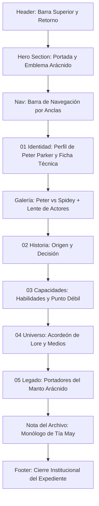

# Documentación Técnica y de Diseño UX/UI — Expediente Spider-Man

**Proyecto:** Expediente de Personaje / Dossier de Héroe (`spider-man.html`)  
**Materia/Ámbito:** Programación Web Dinámica  
**Fecha:** Octubre 2026  
**Rol:** Desarrollador Frontend & Diseñador UX/UI  

---

## 1. Resumen Ejecutivo del Proyecto

La página de detalle **Spider-Man (Expediente 001 / Marvel)** constituye la vista profunda ("deep-dive") del héroe dentro de la plataforma *Icons Archive*. Diseñada como un **dossier de inteligencia editorial clasificado**, la página combina el rigor estilístico de una novela gráfica de autor con la interactividad y dinamismo de una aplicación web moderna.

El objetivo central de esta pieza es narrar el origen, la identidad dual (Peter Parker vs. Spider-Man), los hitos cinematográficos, las habilidades, el lore multiversal y el legado de los distintos portadores del manto arácnido, manteniendo una experiencia fluida, accesible y plenamente adaptativa en todas las resoluciones.

---

## 2. Concepto Visual y Sistema de Diseño (Design System)

### 2.1. Dirección de Arte: "Dossier Clasificado de Novela Gráfica"
A diferencia de sitios web convencionales de cómics basados en cuadrículas saturadas y colores estridentes, la dirección visual adopta:
* **Atmósfera Dark / Noir de Archivo (`#07090e`):** Fondo negro carbón profundo con texturas sutiles de telaraña vectorial y degradados radiales nocturnos.
* **Jerarquía Solemne:** Contrastes de escala tipográfica monumental combinados con micro-etiquetas técnicas (coordenadas, códigos de archivo, años de estreno).
* **Tratamiento Cinematográfico:** Tarjetas con marcos fotográficos biselados, degradados internos y desenfoques por capas (`backdrop-filter: blur(10px)`).

### 2.2. Tipografía y Escala
La experiencia tipográfica se apoya en una tríada armónica cargada de intención semántica:

| Familia Tipográfica | Rol en la Interfaz | Justificación Estilística |
|---|---|---|
| **Cinzel** (Serif) | Títulos principales, cabeceras de sección (`h1`, `h2`, `h3`) | Aporta autoridad, peso histórico y solemnidad de archivo clasificado. |
| **Barlow Condensed** (Sans-Serif) | Insignias, kickers, numeraciones técnicas, coordenadas y botones | Evoca los rotulados y créditos clásicos del cómic tradicional americano. |
| **DM Sans** (Sans-Serif) | Textos de cuerpo, descripciones, citas y listas de hechos | Garantiza legibilidad óptima y descanso visual en lecturas extensas. |

### 2.3. Paleta Cromática y Tokens CSS (`spider-man.css`)
```css
:root {
  color-scheme: dark;
  --bg: #07090e;             /* Fondo primario noir */
  --bg-surface: #0e121b;     /* Superficie de paneles */
  --bg-card: #131724;        /* Fondo de tarjetas */
  --panel: #111420;          /* Fondo de bloques */
  
  --text: #f8fafc;           /* Blanco tiza de alta legibilidad */
  --text-secondary: #cbd5e1; /* Gris claro secundario */
  --muted: #94a3b8;          /* Gris atenuado para metadatos */
  
  --red: #e62429;            /* Rojo carmesí clásico Marvel */
  --red-hover: #ff383e;      /* Rojo energizado en interacción */
  --red-glow: rgba(230, 36, 41, 0.4);
  --red-subtle: rgba(230, 36, 41, 0.12);
  
  --gold: #e5b958;           /* Dorado de expedientes y archivo */
  --gold-glow: rgba(229, 185, 88, 0.3);
  --gold-subtle: rgba(229, 185, 88, 0.1);
  
  --line: rgba(255, 255, 255, 0.08); /* Delimitadores minimalistas */
}
```

---

## 3. Estructura y Arquitectura de Componentes

La página se organiza de forma semántica bajo estándares de HTML5:



### 3.1. Barra de Encabezado (`.detail-top`)
* Enlace de retorno `← VOLVER AL SELECTOR` hacia el catálogo principal (`index.html`).
* Marca institucional `ICONS ARCHIVE` y placa identificatoria `EXPEDIENTE 001 / MARVEL`.
* Disposición fija y flotante con fondo traslúcido y desenfoque para navegación continua.

### 3.2. Sección Hero (`#inicio`)
* **Título Monumental:** Tipografía escalable con acento cromático diferencial (`SPIDER<span>MAN</span>`).
* **Kicker Editorial:** Indicador contextual `EL TREPAMUROS DE NUEVA YORK`.
* **Emblema Arácnido con Coordenadas:** Logo oficial de Spider-Man (`img/spider-man/logo_sm.webp`) enmarcado en una órbita circular decorativa (`.mark-orbit`) y acompañado de las coordenadas geográficas reales de Queens, Nueva York (`40°43′ N, 73°47′ W`).
* **Indicador de Desplazamiento (`.scroll-cue`):** Micro-enlace con flecha animada hacia el perfil.

### 3.3. Barra de Navegación por Secciones (`.section-nav`)
* Menú anclado horizontal con enlaces de salto rápido: `PERFIL`, `GALERÍA`, `HISTORIA`, `HABILIDADES`, `UNIVERSO` y `PORTADORES`.
* Permite recorrer el documento de forma ágil sin perder la posición contextual.

### 3.4. Sección 01 / Identidad (`#perfil`)
* **Tarjeta de Perfil (`.profile-card`):** Tipografía serif con énfasis en `Peter Parker`, acompañada de la icónica sentencia *“WITH GREAT POWER…”*.
* **Ficha Técnica (`.fact-list`):** Datos organizados en pares clave-valor (Nombre, Identidad, Origen, Ocupación y Afiliaciones como Avengers y Fantastic Four).

### 3.5. Galería Personal (`#galeria`)
Esta sección se subdivide en dos módulos de alto impacto visual:
1. **Dicotomía "El héroe y su máscara":**
   * Tarjetas duales en proporción vertical (4:5): Peter Parker civil (`01`) frente a Spider-Man portando el traje (`02`).
   * Efecto hover con zoom sutil (`scale(1.05)`), bordes internos pespunteados y rótulos en vidrio escarchado.
2. **"En la pantalla grande — Actores que lo protagonizaron":**
   * Retratos de Tobey Maguire (2002), Andrew Garfield (2012) y Tom Holland (2016).
   * **Mecanismo interactivo de lente reveladora** (detallado en la Sección 4).

### 3.6. Sección 02 / El Comienzo (`#historia`)
* Bloque de transición horizontal con una ilustración de telaraña vectorial estilizada (`img/spider-man/spider-web.svg`).
* Relato del origen radioactivo y la trágica lección del tío Ben que forjó la brújula moral del personaje.

### 3.7. Sección 03 / Capacidades (`#habilidades`)
* **Grilla de Habilidades:** 4 tarjetas que desglosan el sentido arácnido, fuerza/agilidad, adherencia a superficies y su genio científico.
* **Módulo de Punto Débil (`.weakness`):** Resalta la vulnerabilidad inherente de su humanidad, el agotamiento físico y la dependencia del fluido de sus telarañas.

### 3.8. Sección 04 / Su Universo (`#universo`)
* **Acordeón Nativo Accesible (`<details>` y `<summary>`):** Cuatro pestañas con interacción fluida sin librerías pesadas:
  1. *Aliados:* Tía May, Mary Jane Watson, Johnny Storm, The Avengers.
  2. *Enemigos:* Green Goblin, Doctor Octopus, Venom, Kraven the Hunter.
  3. *Versiones más famosas:* Peter clásico, Miles Morales, Spider-Man 2099, Superior Spider-Man, Spider-Gwen.
  4. *What If? célebres:* Unión a los Fantastic Four, mutación de seis brazos, supervivencia de Gwen Stacy, Peter como Punisher.
* **Columnas de Medios:** Clasificación cronológica y recomendaciones en cine, series animadas de televisión y cómics de referencia histórica.

### 3.9. Sección 05 / Legado Arácnido (`#portadores`)
* Tarjetas dedicadas a Miles Morales, Ben Reilly (Scarlet Spider), Otto Octavius (Superior Spider-Man) y Miguel O'Hara (Spider-Man 2099).
* Monogramas distintivos y enlaces externos directos a la base de datos oficial de Marvel.

### 3.10. Nota del Archivo y Footer (`.curiosity` / `.detail-footer`)
* Cita textual del monólogo de la Tía May de *Spider-Man 2* sobre el valor del héroe interior y la necesidad de inspiración en la sociedad.
* Botón de retorno al inicio (`VOLVER AL INICIO ↑`) y cierre de expediente.

---

## 4. Ingeniería Interactiva: Lente Reveladora de Máscara (`spider-man.js`)

Uno de los puntos culminantes de interacción de la página es la **lente dinámica** que sigue al puntero sobre las tarjetas de los actores cinematográficos para revelar progresivamente su respectiva máscara.

```
       [ Cursor del Usuario ]
                  │
                  ▼ (pointermove)
┌───────────────────────────────────────────────┐
│              .actor-frame                     │
│                                               │
│   ┌───────────────────────────────────────┐   │
│   │ .actor-photo (Foto base del actor)    │   │
│   └───────────────────────────────────────┘   │
│                      ▲                        │
│                      │ mask-image             │
│   ┌──────────────────┴────────────────────┐   │
│   │ .actor-reveal (Máscara arácnida)      │   │
│   │ - radial-gradient centrado en cursor  │   │
│   └───────────────────────────────────────┘   │
│                      ▲                        │
│   ┌──────────────────┴────────────────────┐   │
│   │ .actor-lens (Anillo animado / mira)   │   │
│   │ - Rotación continua @keyframes        │   │
│   └───────────────────────────────────────┘   │
└───────────────────────────────────────────────┘
```

### 4.1. Fundamento Matemático y Lógica de Animación
* **Interpolación Lineal (Lerp):** En lugar de mover la lente de forma rígida con el mouse, se aplica una suavización progresiva:
  $$\text{current} = \text{current} + (\text{target} - \text{current}) \times \text{EASE}$$
  Donde $\text{EASE} = 0.35$ genera un seguimiento elástico y orgánico.
* **Radio Proporcional al Contenedor:** El tamaño de la lente se calcula en base al ancho de la tarjeta (`Math.round(frame.offsetWidth * 0.24)`), asegurando que funcione a la perfección sin importar la resolución.
* **Inyección de Propiedades Personalizadas CSS:** El script actualiza directamente en el DOM:
  * `--mx`, `--my`: Coordenadas centrales de la máscara.
  * `--lens`: Radio del degradado circular.
  * `--lx`, `--ly`: Coordenadas de posición del anillo/mira.
  * `--lens-px`: Diámetro total del anillo exterior.
* **Bucle Eficiente (`requestAnimationFrame`):** La animación sólo se ejecuta mientras el puntero está dentro de la tarjeta o mientras el movimiento residual se estabiliza ($\Delta > 0.3\text{px}$), suspendiendo el consumo de GPU/CPU en estado inactivo.

---

## 5. Optimización Responsive y Correcciones Técnicas

### 5.1. Diagnóstico del Error de Desbordamiento en Móviles
Durante las pruebas de visualización en pantallas de celular (anchos entre 320px y 480px), las tarjetas de la sección *"GALERÍA PERSONAL — El héroe y su máscara"* generaban un desbordamiento horizontal hacia la derecha de la pantalla.

**Causa Raíz:**
1. La clase `.photo-frame` poseía una altura declarada mediante:
   ```css
   @media (max-width: 480px) {
     .photo-frame { height: clamp(430px, 125vw, 520px); }
   }
   ```
2. Combinada con la regla `aspect-ratio: 4 / 5`, el navegador calculaba el ancho a partir de la altura:
   $$\text{ancho} = \text{alto} \times \frac{4}{5} = 125\text{vw} \times 0.8 = 100\text{vw}$$
3. Con un ancho base de `100vw`, al sumarse el padding lateral de la sección contenedora (`16px` por lado = `32px` totales), el elemento alcanzaba `100vw + 32px`.
4. El contenedor obligaba a la página a expandirse fuera de la pantalla, provocando scroll horizontal involuntario.

### 5.2. Solución Aplicada
1. **Sustitución por Modelo de Ancho Porcentual Fluido:**
   ```css
   .photo-frame {
     width: 100%;
     max-width: 100%;
     min-width: 0;
     height: auto;
     aspect-ratio: 4 / 5;
   }
   ```
   Al asignar `width: 100%` y `height: auto`, la tarjeta ocupa exactamente el ancho provisto por su columna en el grid, derivando su altura proporcional de forma segura.
2. **Contención del Grid:** Se aseguró `width: 100%` y `box-sizing: border-box` en `.photo-grid` y `.actor-grid` en todos los media queries (`900px`, `820px`, `720px`, `480px`).
3. **Contención de Sección:** Se incorporó `overflow: hidden` a `.photo-gallery` para salvaguardar la vista de cualquier fuga subpixel.
4. **Optimización de Textos en Móvil:** Se ajustaron los márgenes y paddings de `.photo-caption` a `14px` en pantallas reducidas para evitar saltos de línea antiestéticos.

---

## 6. Accesibilidad (A11y), Rendimiento y Estándares Web

* **Soporte para Movimiento Reducido (`prefers-reduced-motion`):**
  Tanto en CSS como en JavaScript (`spider-man.js`), si el usuario tiene activada la preferencia de reducción de movimiento en su sistema operativo, el factor de amortiguación `EASE` se fija en `1` (seguimiento instantáneo sin inercia) y las animaciones de rotación infinita quedan neutralizadas.
* **Semántica HTML y ARIA:**
  * Uso de etiquetas estructurales `<header>`, `<main>`, `<section>`, `<article>`, `<details>`, `<summary>` y `<footer>`.
  * Elementos puramente visuales (capas de máscara y anillos decorativos) marcados con `aria-hidden="true"`.
  * Emblemas con `aria-label` descriptivos.
* **Seguridad y Enlaces Salientes:**
  Todos los enlaces a recursos externos (perfiles oficiales de Marvel Comics) cuentan con los atributos de seguridad `target="_blank"` y `rel="noreferrer"`.
* **Cero Dependencias Externas:**
  Toda la interactividad está construida en JavaScript Vanilla y CSS puro, prescindiendo de librerías como jQuery, Bootstrap o Tailwind, garantizando una carga inmediata y una huella de transferencia ultra ligera.

---

## 7. Mapa de Archivos del Proyecto

| Archivo | Tipo | Función Principal |
|---|---|---|
| [`spider-man.html`](file:///c:/Users/sanma/Desktop/escuela/programacion%20web%20dinamica/proyecto%201/spider-man.html) | HTML5 | Estructura semántica, contenidos del expediente, citas, tarjetas y navegación. |
| [`spider-man.css`](file:///c:/Users/sanma/Desktop/escuela/programacion%20web%20dinamica/proyecto%201/spider-man.css) | CSS3 | Sistema de diseño, tokens, paleta cromática, maquetación Grid/Flexbox y media queries. |
| [`spider-man.js`](file:///c:/Users/sanma/Desktop/escuela/programacion%20web%20dinamica/proyecto%201/spider-man.js) | JS (ES6+) | Lógica de la lente interactiva, cálculo vectorial y actualización de variables CSS. |
| [`documentacion/contexto.md`](file:///c:/Users/sanma/Desktop/escuela/programacion%20web%20dinamica/proyecto%201/documentacion/contexto.md) | Markdown | Documentación general de la pantalla de selección principal (Hero Archive). |
| [`documentacion/spider-man.md`](file:///c:/Users/sanma/Desktop/escuela/programacion%20web%20dinamica/proyecto%201/documentacion/spider-man.md) | Markdown | Documentación técnica y de diseño específica del expediente de Spider-Man. |
