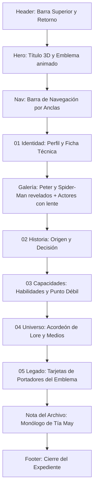

# Documentación Técnica y de Diseño UX/UI — Expediente Spider-Man

**Proyecto:** Expediente de Personaje / Dossier de Héroe (`spider-man.html`)  
**Materia/Ámbito:** Programación Web Dinámica  
**Fecha:** Octubre 2026  
**Rol:** Desarrollador Frontend & Diseñador UX/UI  

---

## 1. Resumen Ejecutivo del Proyecto

La página de detalle **Spider-Man (Expediente 001 / Marvel)** es la vista profunda del héroe dentro de *Icons Archive*. Está pensada como un **dossier de archivo clasificado**: combina el rigor visual de una novela gráfica con interacciones y animaciones de una aplicación web moderna.

El objetivo es narrar el origen, la identidad dual (Peter Parker frente a Spider-Man), los actores que lo interpretaron, las habilidades, el universo multiversal y el legado de los portadores del manto arácnido. La experiencia tiene que funcionar bien en escritorio, tablet y celular, y respetar a quienes prefieren menos movimiento.

---

## 2. Concepto Visual y Sistema de Diseño (Design System)

### 2.1. Dirección de Arte: "Dossier Clasificado de Novela Gráfica"
A diferencia de los sitios de cómics basados en cuadrículas saturadas, la dirección visual adopta:
* **Atmósfera Noir de Archivo (`#07090e`):** Fondo negro carbón con texturas sutiles de telaraña y degradados radiales nocturnos.
* **Jerarquía Solemne:** Contrastes de escala tipográfica monumental combinados con micro-etiquetas técnicas (códigos de archivo, años, insignias).
* **Tratamiento Cinematográfico:** Marcos fotográficos con bordes finos, reflejos de luz que siguen al cursor y profundidad real (perspectiva 3D) en los elementos clave.

### 2.2. Tipografía y Escala
| Familia Tipográfica | Rol en la Interfaz | Justificación Estilística |
|---|---|---|
| **Cinzel** (Serif) | Títulos principales, cabeceras de sección (`h1`, `h2`, `h3`) | Aporta autoridad y solemnidad de archivo. |
| **Barlow Condensed** (Sans-Serif) | Insignias, kickers, numeraciones, etiquetas de las fotos y botones | Evoca los rotulados clásicos del cómic. |
| **DM Sans** (Sans-Serif) | Textos de cuerpo, descripciones, citas y fichas | Legibilidad en lecturas extensas. |

### 2.3. Paleta Cromática y Tokens CSS (`spider-man.css`)
```css
:root {
  color-scheme: dark;
  --bg: #07090e;             /* Fondo primario noir */
  --bg-surface: #0e121b;     /* Superficie de paneles */
  --bg-card: #131724;        /* Fondo de tarjetas */
  --panel: #111420;          /* Fondo de bloques */

  --text: #f8fafc;           /* Blanco tiza */
  --text-secondary: #cbd5e1; /* Gris claro secundario */
  --muted: #94a3b8;          /* Metadatos */

  --red: #e62429;            /* Rojo carmesí Marvel */
  --red-hover: #ff383e;      /* Rojo en interacción */
  --red-glow: rgba(230, 36, 41, 0.4);
  --red-subtle: rgba(230, 36, 41, 0.12);

  --gold: #e5b958;           /* Dorado de expedientes */
  --gold-glow: rgba(229, 185, 88, 0.3);
  --gold-subtle: rgba(229, 185, 88, 0.1);

  --line: rgba(255, 255, 255, 0.08);
}
```

---

## 3. Estructura y Arquitectura de Componentes



### 3.1. Barra de Encabezado (`.detail-top`)
* Enlace de retorno `← VOLVER AL SELECTOR` hacia `index.html`.
* Marca `ICONS ARCHIVE` y placa `EXPEDIENTE 001 / MARVEL`.
* Barra fija con fondo traslúcido y desenfoque.

### 3.2. Sección Hero (`#inicio`)
* **Título en 3D (`.title-3d`):** `SPIDER` y `MAN` están formados por tres capas (ver sección 4.1). Entran desde atrás con un desenfoque que se resuelve, y `MAN` aparece un instante después.
* **Kicker Editorial:** `EL TREPAMUROS DE NUEVA YORK`.
* **Emblema Arácnido (`.hero-mark`):** Logo oficial (`img/spider-man/logo_sm.webp`) dentro de una órbita decorativa. Al cargar, la órbita se abre, el núcleo aparece y el logo baja colgado de un hilo de telaraña (`.mark-thread`), se balancea y queda quieto. Dentro del núcleo hay una telaraña tenue (`spider-web.svg`).
* **Indicador de Desplazamiento (`.scroll-cue`):** Enlace con flecha animada hacia el perfil.
* **Sin coordenadas:** el elemento que mostraba la ubicación (`40°43′ N / 73°47′ W`) se eliminó junto con sus estilos. No se reemplazó por otro texto.

### 3.3. Barra de Navegación por Secciones (`.section-nav`)
* Menú anclado con: `PERFIL`, `GALERÍA`, `HISTORIA`, `HABILIDADES`, `UNIVERSO` y `PORTADORES`.

### 3.4. Sección 01 / Identidad (`#perfil`)
* **Tarjeta de Perfil (`.profile-card`):** `Peter Parker` en serif con la sentencia *“WITH GREAT POWER…”*.
* **Ficha Técnica (`.fact-list`):** Pares clave-valor (Nombre, Identidad, Origen, Ocupación y Afiliaciones).

### 3.5. Galería Personal (`#galeria`)
1. **"El héroe y su máscara":**
   * Dos fotos en proporción 4:5 con subtítulos **`PETER PARKER · LA PERSONA`** y **`SPIDER-MAN · EL SÍMBOLO`**.
   * Entran al hacer scroll: Peter sube desde abajo con un recorte que se abre; Spider-Man se revela desde el centro, como una máscara que se descubre (sección 4.2).
   * Entre las dos hay un medallón con un hilo de telaraña que las une (`.photo-link`). Se oculta en tablet y celular.
   * Al pasar el mouse por una foto, la otra se apaga.
2. **"En la pantalla grande — Actores que lo protagonizaron":**
   * Retratos de Tobey Maguire (2002), Andrew Garfield (2012) y Tom Holland (2016).
   * Lente reveladora que sigue al cursor (sección 5) y clic o toque para mostrar la máscara completa.

### 3.6. Sección 02 / El Comienzo (`#historia`)
* Bloque de transición con una telaraña vectorial (`img/spider-man/spider-web.svg`).
* Relato del origen radioactivo y la lección del tío Ben.

### 3.7. Sección 03 / Capacidades (`#habilidades`)
* **Grilla de Habilidades:** 4 tarjetas (sentido arácnido, fuerza y agilidad, adherencia, mente científica).
* **Punto Débil (`.weakness`):** la humanidad debajo de la máscara, el cansancio y el fluido de las telarañas.

### 3.8. Sección 04 / Su Universo (`#universo`)
* **Acordeón nativo (`<details>` y `<summary>`):** Aliados, Enemigos, Versiones más famosas y What If? célebres.
* **Columnas de Medios:** Películas, Series y Cómics esenciales.

### 3.9. Sección 05 / Portadores del Emblema (`#portadores`)
Cada personaje es una **tarjeta de selección**, como en una pantalla de elegir personaje de un videojuego:
* **Foto (`.bearer-photo`):** es un `<button>`, así que se puede seleccionar con mouse, toque o teclado. Tiene la insignia de número (`01`–`04`), una etiqueta de época (`ULTIMATE · 2011`, `CLON · 1975`, `SUPERIOR · 2013`, `NUEVA YORK · 2099`) y la marca `SELECCIONADO` cuando está activa.
* **Cuerpo (`.bearer-body`):** nombre, descripción y enlace al perfil de Marvel.
* **Color propio:** cada tarjeta tiene su color (`--card-tone`) que tiñe el borde, la insignia y el resplandor.
* **Fotos:** `img/spider-man/miles morales.webp`, `ben reilly.webp`, `otto.webp` y `miguel.webp`. Cada una tiene su encuadre (`object-position`) para que la cara quede dentro del recorte 4:5.
* **Diseño de reemplazo:** si alguna foto no carga, la tarjeta muestra una telaraña con la inicial del personaje en contorno en lugar de una imagen rota.

### 3.10. Nota del Archivo y Footer (`.curiosity` / `.detail-footer`)
* Monólogo de la Tía May sobre el valor del héroe interior.
* Enlace al perfil oficial de Marvel y botón `VOLVER AL INICIO ↑`.

---

## 4. Animaciones de Entrada y Efectos 3D

### 4.1. Título "SPIDER-MAN" en 3D
Cada línea del título son tres capas apiladas:
1. **Cuerpo extruido:** la capa de texto base lleva sombras de `text-shadow` apiladas hacia abajo, que dan el espesor de la letra.
2. **Cara frontal (`::before`):** con degradado metálico (blanco en SPIDER, rojo en MAN). Tiene `text-shadow: none` para no heredar las sombras del cuerpo, que la tapaban.
3. **Reflejo (`::after`):** una franja de luz que cruza las letras (`@keyframes title-sheen`, ciclo de 7 s; en hover, 1.6 s).

La inclinación al pasar el mouse la calcula `spider-man.js` y la aplica como `--tx` / `--ty` con `rotateX` y `rotateY`, con un máximo de 7°.

### 4.2. Logo y emblema
* **Órbita (`orbit-arrive`):** se abre desde 60% de escala.
* **Núcleo (`core-arrive`):** aparece desde 40% con desenfoque.
* **Hilo (`thread-drop`):** baja, se mantiene y se desvanece.
* **Logo (`glyph-drop`):** baja desde arriba, se balancea (+7°, −5°, +2°) y queda quieto. Dura 1.6 s con retraso de 0.65 s.
* **Hover:** el núcleo se inclina en 3D (máximo 14°), el logo crece al 110%, la telaraña interna se enciende, se ilumina el brillo metálico y sale una onda de energía (`core-shock`).
* **Brillo metálico (`glyph-sheen`):** una copia blanca del logo con una máscara diagonal que se mueve, así el brillo solo se ve sobre la forma de la araña. Se mezcla con `overlay`.

### 4.3. Galería: revelado de Peter y Spider-Man
* **Entrada:** cada `[data-reveal]` empieza oculto (`.will-reveal`) y cuando entra en pantalla pasa a `.is-visible`. `IntersectionObserver` lo detecta con un umbral de 25%.
* **Peter (`peter-in`):** sube y se corre con `translate`, rota en Y y se abre desde abajo con `clip-path`.
* **Spider-Man (`spider-in`):** se revela desde el centro con `clip-path: circle()`, como una máscara que se descubre.
* **Imagen (`img-settle`):** la foto arranca con 125% de escala y brillo bajo, y se asienta.
* **Subtítulos (`caption-up`) y medallón (`link-pop`):** entran después de la foto.
* **Hover:** la foto con el mouse se inclina en 3D y gana un reflejo de luz que sigue al cursor (`--gx` / `--gy`). La otra foto baja de brillo y escala (`:has()`).

### 4.4. Portadores del emblema
* **Entrada escalonada (`card-in`):** cada tarjeta sube 60px, rota 22° en X y escala desde 94%, con un retraso de 0.12 s entre tarjetas (`--i`).
* **Hover:** la tarjeta sube 10px y se inclina en 3D, el borde toma su color, la insignia se enciende y la foto se agranda con una franja de luz que la cruza (`title-sheen`).
* **Selección:** al hacer clic, la tarjeta marca `SELECCIONADO`, tiene un destello interior (`select-flash`) y el resto se apaga (`.has-selection`). Otro clic la deselecciona.

---

## 5. Ingeniería Interactiva (`spider-man.js`)

El script está dividido en cuatro bloques:

### 5.1. Inclinación 3D (`addTilt`)
Calcula la posición del puntero dentro del área y la traduce a `--tx`, `--ty` (grados) y `--gx`, `--gy` (posición del reflejo). Se aplica al emblema, al título, a las fotos de la galería y a las tarjetas de portadores. No se activa en dispositivos sin hover (celulares) ni con movimiento reducido.

### 5.2. Entradas al hacer scroll
Asigna a cada `[data-reveal]` su posición dentro del grupo (`--i`) para escalonar la entrada y agrega `.will-reveal`. Cuando el elemento aparece en pantalla, cambia a `.is-visible` y deja de observarse.

### 5.3. Lente de la galería de actores
Mantiene la lente de la versión anterior con algunos cambios:
* **Seguimiento con suavizado** (`EASE = 0.25`).
* **Radio:** 24% del ancho de la tarjeta.
* **Clic o toque:** alterna el modo **máscara completa** (`.is-full`). El radio crece hasta cubrir toda la foto y el seguimiento se detiene. Otro clic lo vuelve a su tamaño.
* Variables que se actualizan en el DOM: `--mx`, `--my`, `--lens`, `--lx`, `--ly`, `--lens-px`.
* El bucle `requestAnimationFrame` solo corre mientras hay movimiento o la lente está activa.

### 5.4. Portadores
* **Fotos faltantes:** si una imagen no carga, se quita y la tarjeta queda con el diseño de reemplazo (clase `.no-photo`).
* **Selección:** una tarjeta por vez. Maneja `aria-pressed` para lectores de pantalla.

---

## 6. Optimización Responsive y Correcciones Técnicas

### 6.1. Desbordamiento horizontal en celulares (corregido)
Las tarjetas de la galería desbordaban en pantallas chicas porque `.photo-frame` tenía una altura fija en vw que, combinada con `aspect-ratio: 4 / 5`, forzaba un ancho de `100vw` más el padding de la sección. La solución fue usar `width: 100%` y `height: auto`, con `box-sizing: border-box` en las grillas y `overflow: hidden` en la sección.

### 6.2. Galería en tablet (corregido hoy)
Entre 720 px y 900 px la foto de Peter ocupaba todo el ancho de la pantalla porque la grilla de dos columnas se mantenía sin límite de ancho. Ahora la regla de una columna y `max-width: 480px` se aplica desde 900 px.

### 6.3. Título sin sombras heredadas (corregido hoy)
Las capas `::before` y `::after` del título heredaban el `text-shadow` del cuerpo. Eso tapaba la cara metálica y dejaba la palabra gris. Se fijó `text-shadow: none` en ambas capas.

### 6.4. Breakpoints
* **1080 px:** las tarjetas de habilidades y las de la sección de leyendas pasan a 2 columnas.
* **900 px:** el héroe se centra en una columna. La galería pasa a una columna y se oculta el medallón de unión.
* **820 px:** los actores pasan a una columna.
* **600 px:** las tarjetas de portadores se limitan a 380 px y la foto pasa a proporción 4:3.6.

---

## 7. Accesibilidad (A11y), Rendimiento y Estándares Web

* **Movimiento reducido (`prefers-reduced-motion`):**
  * En CSS, se desactivan las animaciones del título, el logo, el núcleo y la órbita. Las entradas de las fotos y las tarjetas quedan visibles desde el inicio, sin transformaciones.
  * En JS, `EASE` vale 1 (la lente sigue al instante), no se activa la inclinación 3D y no se usan las entradas al hacer scroll.
* **Teclado y lectores de pantalla:**
  * Las tarjetas de portadores son `<button>` con `aria-pressed`.
  * El título tiene `aria-label="Spider-Man"` y sus capas visuales están marcadas con `aria-hidden`.
  * Los elementos decorativos (órbitas, hilos, telaraña, brillos, lente) tienen `aria-hidden`.
* **Táctil:** la inclinación 3D solo se activa con `(hover: hover)`. La lente de actores se controla con toque (clic).
* **Semántica:** `<header>`, `<main>`, `<section>`, `<article>`, `<details>`, `<summary>`, `<footer>`.
* **Enlaces externos:** `target="_blank"` con `rel="noreferrer"`.
* **Sin dependencias:** JavaScript vanilla y CSS puro. `IntersectionObserver` y `:has()` son soportados por los navegadores actuales.

---

## 8. Mapa de Archivos del Proyecto

| Archivo | Tipo | Función Principal |
|---|---|---|
| `spider-man.html` | HTML5 | Estructura semántica, contenidos del expediente, galería, tarjetas de portadores y navegación. |
| `spider-man.css` | CSS3 | Tokens, maquetación, título 3D, animaciones de entrada, efectos de hover y responsive. |
| `spider-man.js` | JS (ES6+) | Inclinación 3D, entradas al hacer scroll, lente de actores (con máscara completa) y selección de portadores. |
| `documentacion/contexto.md` | Markdown | Documentación general de la pantalla de selección principal. |
| `documentacion/spider-man.md` | Markdown | Este documento. |

---

## 9. Historial de Cambios

| Cambio | Detalle |
|---|---|
| Logo animado | Entrada con órbita, núcleo, hilo de telaraña y balanceo. Hover con inclinación 3D, telaraña encendida y onda de energía. Brillo metálico sobre la forma del logo. |
| Título 3D | Tres capas con cara metálica, cuerpo extruido y reflejo de luz. Inclinación al pasar el mouse. |
| Coordenadas eliminadas | Se quitaron el elemento, su HTML y sus estilos. |
| Galería "El héroe y su máscara" | Revelado al hacer scroll (Peter sube, Spider-Man se descubre), subtítulos nuevos, medallón de unión y apagado de la foto no seleccionada. |
| Actores | Clic o toque para mostrar la máscara completa. Entrada escalonada. |
| Portadores del emblema | Tarjetas de selección con las fotos de Miles Morales, Ben Reilly, Otto Octavius y Miguel O’Hara, entrada escalonada, hover 3D y selección. Si una foto falta, queda un diseño de reemplazo. |
| Correcciones | Galería en tablet, título con sombras heredadas y helper de fotos faltantes. |

---

## 10. Pendientes y Observaciones

* **Fuentes:** se cargan desde Google Fonts. Sin conexión, la página usa fuentes de reemplazo.
* **Compatibilidad:** `:has()` y `mask-image` requieren navegadores actuales. En navegadores viejos, la galería y el brillo del logo se ven sin esos efectos, pero el contenido sigue visible.
